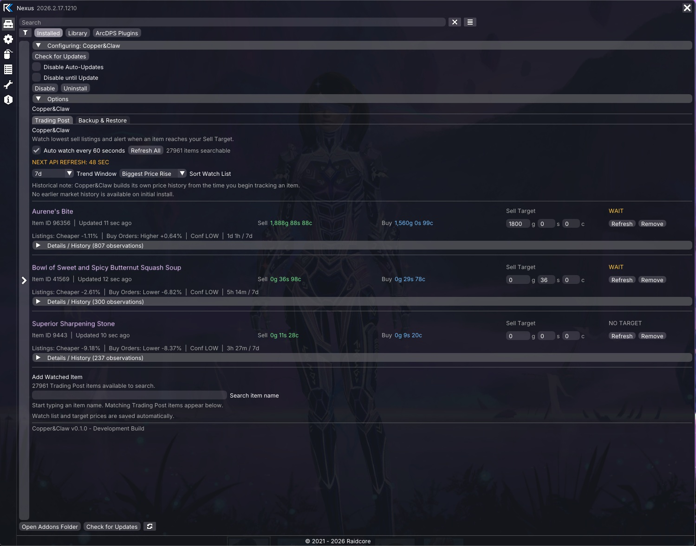
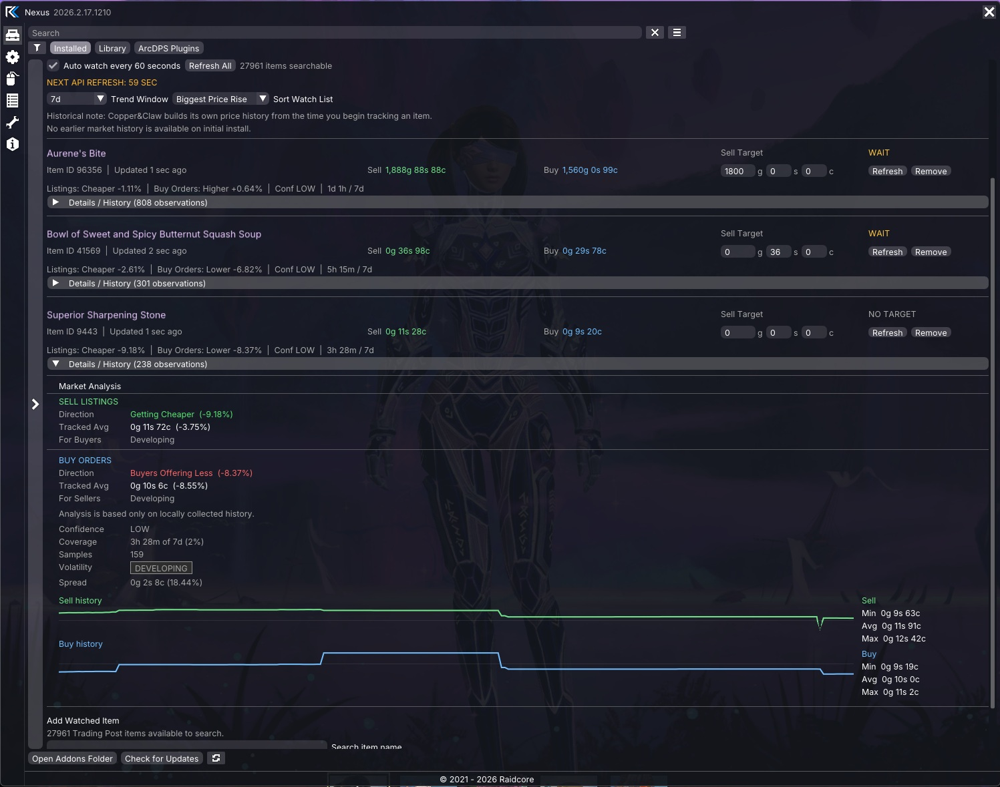
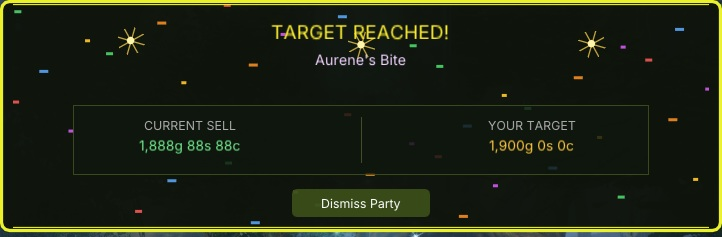
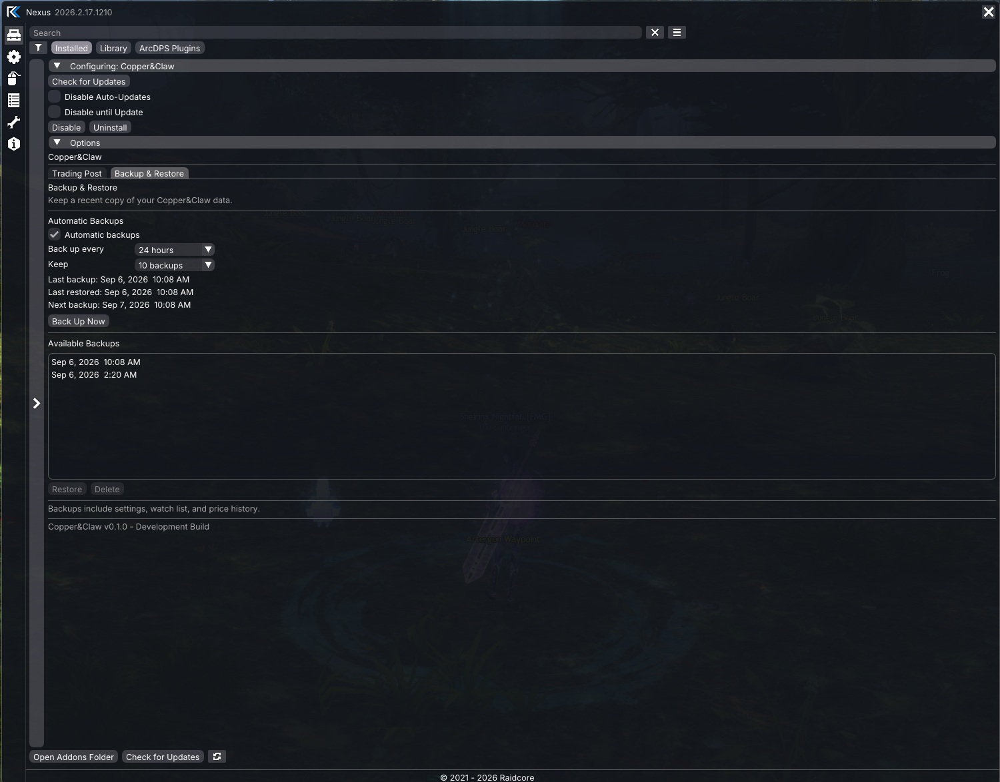
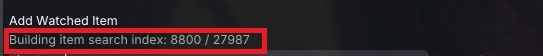

# Copper&Claw

Copper&Claw is a standalone **Guild Wars 2 Nexus addon** for tracking Trading Post prices, building local price history, analyzing market movement, and alerting you when watched items reach a target price.

## Status

**Latest Release:** v0.1.1  
**Development:** Active

---

## Main Features

- Watch multiple Trading Post items
- Automatic price refresh every 60 seconds
- Manual per-item refresh and Refresh All
- Current **lowest sell listing**
- Current **highest buy order**
- Per-item **Sell Targets**
- Persistent watch list, targets, settings, and price history
- Search items without requiring manual item IDs
- Variant-aware search for duplicate-name items
- Separate **Sell Listings** and **Buy Orders** market analysis
- Gap-aware confidence and coverage
- Colored **Volatility** classification
- Sortable watch list
- Sell / Buy price-history sparklines
- Historical minimum / average / maximum prices
- Dragon Bash-style **Target Reached** alerts
- Built-in automatic **Backup & Restore** for local Copper&Claw data

---

## Watch List Sorting

Watched items can be reordered without changing their saved watch-list order.

Current sort options:

- Added Order
- Name A-Z
- Closest to Target
- Biggest Price Drop
- Biggest Price Rise
- Most Volatile
- Least Volatile

Price-rise, price-drop, and volatility sorting use the selected **Trend Window**.

Volatility sorting uses the same gap-aware history requirements as the Volatility badge. Items still marked **DEVELOPING** are placed below items with mature volatility data.

---

## Market Analysis

Copper&Claw separates the two sides of the Trading Post market.

### Sell Listings

- Direction
- % movement
- Recent average
- Price position
- Buyer-facing signal

### Buy Orders

- Direction
- % movement
- Recent average
- Price position
- Seller-facing signal

### Volatility

Copper&Claw summarizes sell-listing price movement with a simple colored badge:

- **CALM**
- **NORMAL**
- **ACTIVE**
- **WILD**
- **DEVELOPING**

The badge uses the selected Trend Window and stays **DEVELOPING** until enough reliable local history has been collected.

### Confidence & Coverage

Copper&Claw also reports:

- Confidence
- Gap-aware selected-window coverage
- Sample count inside the selected trend window

This helps prevent limited or interrupted local history from being presented as mature market data.

---

## Target Alerts

Set a Sell Target for any watched item.

When the current lowest sell listing reaches or drops below that target, Copper&Claw displays a celebration alert.

Alerts include:

- **TARGET REACHED!**
- item name
- current sell price
- your target price
- confetti / celebration effects
- **Dismiss Party**

Multiple triggered alerts are queued and shown one at a time.

---

## Variant-Aware Item Search

Some Guild Wars 2 items share the same visible name while using different item IDs and separate Trading Post listings.

Copper&Claw can distinguish variants such as:

- Power
- Precision
- Toughness
- Vitality
- Healing Power
- Concentration
- Expertise
- Condition Damage

This makes it easier to select the exact Trading Post listing you intended to watch.

---

## Local Price History

Copper&Claw builds its own Trading Post history from observations collected while items are being watched.

Current behavior:

- preserves every successfully recorded observation
- does **not** automatically discard or compact older observations
- retains history across game restarts
- uses locally collected history for trends and analysis

New installations begin with **no historical market data from before tracking started**.

### Trend Windows

- 15m
- 30m
- 1h
- 6h
- 24h
- 3d
- 7d
- 30d
- 90d

---

## Backup & Restore

Copper&Claw includes a dedicated **Backup & Restore** tab for protecting locally collected data.

Automatic backups are enabled by default.

Available backup intervals:

- 6 hours
- 12 hours
- 24 hours
- 3 days
- 7 days

Retention options:

- keep 5 backups
- keep 10 backups
- keep 20 backups

The default configuration is:

- automatic backups: **On**
- backup every: **24 hours**
- keep: **10 backups**

The tab also provides:

- **Back Up Now**
- a simple date/time list of available backups
- **Restore**
- **Delete**
- Last backup
- Next backup
- Last restored

Restore and Delete remain inactive until a backup is selected. Clicking the selected backup again deselects it.

Restores are applied safely on the next Guild Wars 2 startup. Copper&Claw creates an internal safety snapshot before replacing live data, but that recovery mechanism is hidden from the normal backup list so the interface stays simple.

After a successful restore, Copper&Claw records which backup was restored and shows it as **Last restored**.

Backups include:

- Copper&Claw settings
- watched items and Sell Targets
- local Trading Post price history

The item-search cache is not included because Copper&Claw can rebuild it automatically.

---

## First-Time Item Indexing

On first launch, Copper&Claw builds a searchable Trading Post item index using the Guild Wars 2 API.

While the index is building:

- search results may be incomplete
- variant labels may not appear yet
- some items may temporarily be missing from autocomplete

If you see:

`Building item search index...`

allow it to finish before judging search behavior.

---

## Persistence

Copper&Claw saves:

- watched items
- Sell Targets
- settings
- selected Trend Window
- selected watch-list sort mode
- backup settings
- last restored backup information
- local Trading Post history
- cached item-search index

Aurene's Bite is added as a **first-run starter item**, but it can be removed normally and stays removed after restart.

---

## Installation

1. Download `Copper & Claw.dll`
2. Place it in your Guild Wars 2 Nexus addon folder
3. Launch Guild Wars 2
4. Confirm **Copper&Claw** is loaded in Nexus
5. Open the Copper&Claw options panel
6. Allow first-time item indexing to finish if needed

Copper&Claw creates its local settings and data files automatically.

---

## Author

**spectre9510**
